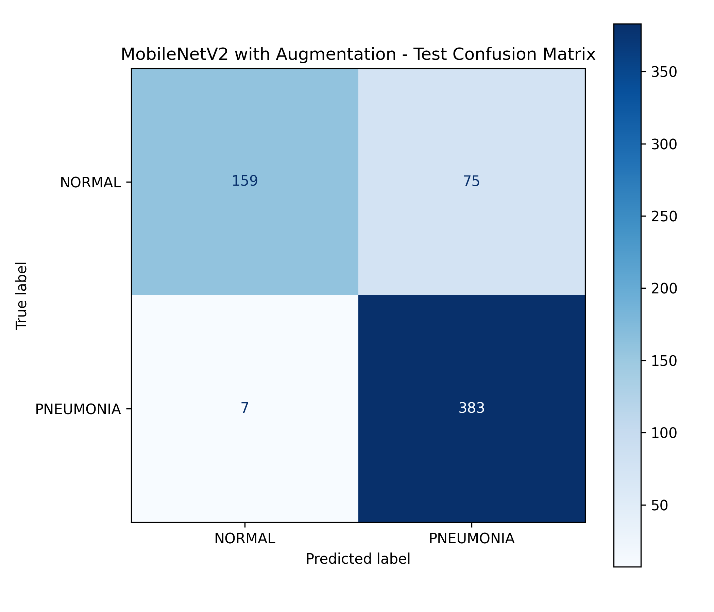
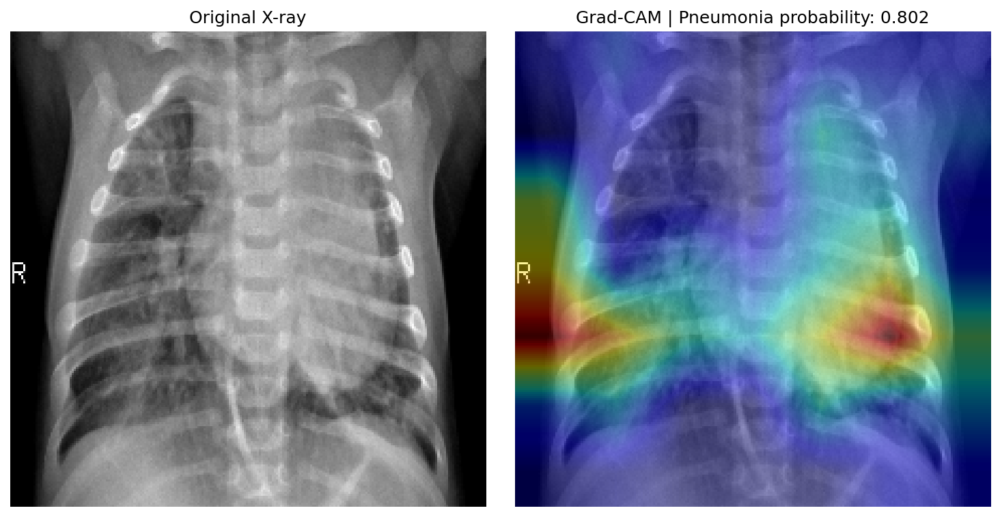

# Pneumonia Detection from Chest X-Ray Images

**An Artificial Intelligence Project for Medical Image Classification**

## Project Overview

This project investigates the classification of chest X-ray images into two categories:

- **NORMAL** — No pneumonia label detected.
- **PNEUMONIA** — Pneumonia label detected.

The objective is to compare traditional machine learning methods with deep learning and evaluate the impact of supplementary training data.

The project also includes Grad-CAM visualizations for model interpretability and a custom Streamlit application called **AURA**.

## Models and Methods

1. **HOG and LBP** — Hand-crafted image feature extraction.
2. **Support Vector Machine (SVM)** — Traditional machine learning baseline.
3. **Random Forest** — Traditional machine learning baseline.
4. **MobileNetV2** — Deep learning architecture for X-ray classification.
5. **Data Augmentation** — Training-time image augmentation.
6. **NIH Supplementary Data** — A small supplementary dataset used during CNN training.
7. **Grad-CAM** — Visualization of image regions influencing model predictions.

## Datasets

### Primary Dataset

**Chest X-Ray Images (Pneumonia)**  
Source: Kaggle — `paultimothymooney/chest-xray-pneumonia`

The primary dataset contains chest X-ray images labeled NORMAL and PNEUMONIA.

The original validation folder was not used. A stratified, group-based validation split was created from the training data. The independent test set was kept separate from training.

### Dataset Statistics

| Split | NORMAL | PNEUMONIA | Total |
|---|---:|---:|---:|
| Training | 1,147 | 3,322 | 4,469 |
| Validation | 194 | 553 | 747 |
| Test | 234 | 390 | 624 |

### Supplementary NIH Dataset

A small balanced subset of the NIH ChestX-ray14 dataset was used as supplementary training data.

- 65 images labeled Pneumonia.
- 48 images labeled No Finding.
- 113 images in total.
- 94 unique patients.

The NIH subset was added to the training data only. The original validation and test sets remained unchanged.

**Important limitation:** NIH labels are report-derived and may be noisy. The No Finding label does not establish that an image is clinically normal. The supplementary subset is small and should not be interpreted as definitive evidence of improved generalization.

## Baseline Models

Traditional machine learning models were evaluated using HOG, LBP, and image intensity features.

### Independent Test Results

| Metric | SVM | Random Forest |
|---|---:|---:|
| Accuracy | 75.00% | 71.96% |
| Balanced Accuracy | 66.75% | 62.95% |
| Precision | 71.51% | 69.30% |
| Pneumonia Recall | 99.74% | 98.97% |
| Specificity | 33.76% | 26.92% |
| F1-score | 83.30% | 81.52% |
| ROC-AUC | 92.96% | 93.39% |

## Deep Learning Model — MobileNetV2

MobileNetV2 was used as the CNN architecture.

The model pipeline includes:

- Input image size: 224 × 224 pixels.
- RGB image preprocessing.
- Data augmentation during training.
- MobileNetV2 feature extraction.
- Global Average Pooling.
- Dropout.
- Sigmoid binary classification output.

A supplementary NIH training experiment was also conducted. The final model is saved as:

`models/mobilenetv2_nih.keras`

### Final Model — Independent Test Results

| Metric | Result |
|---|---:|
| Accuracy | 86.86% |
| Balanced Accuracy | 83.08% |
| Pneumonia Precision | 83.62% |
| Pneumonia Recall | 98.21% |
| Specificity | 67.95% |
| F1-score | 90.33% |
| ROC-AUC | 96.01% |
| PR-AUC | 97.23% |

### Confusion Matrix

| Actual / Predicted | NORMAL | PNEUMONIA |
|---|---:|---:|
| NORMAL | 159 | 75 |
| PNEUMONIA | 7 | 383 |



The model correctly classified 383 pneumonia images and 159 normal images. It misclassified 7 pneumonia images as normal and 75 normal images as pneumonia.

## Model Interpretability — Grad-CAM

Grad-CAM was integrated to visualize image regions that influence the model's predictions.



Grad-CAM provides a visual indication of model attention. It does not prove that the highlighted regions represent pneumonia lesions or provide a clinical explanation.

## AURA — Streamlit Application

**AURA** is the custom interactive interface developed for this project.

The application allows users to:

- Upload chest X-ray images in JPG, JPEG, or PNG format.
- Receive a NORMAL or PNEUMONIA prediction.
- View predicted class probabilities.
- Generate Grad-CAM heatmaps.
- Inspect visual regions influencing the model prediction.

The application uses the NIH-trained MobileNetV2 model and a default decision threshold of 0.50.

### Run AURA Locally

Ensure that the trained model is available at:

`models/mobilenetv2_nih.keras`

Run the following command from the project root:

```bash
python -m streamlit run app.py
```

Then open:

`http://localhost:8501`

The trained model and datasets are not included in the GitHub repository and must be supplied separately.

## Evaluation Metrics

The following metrics are used:

- Accuracy
- Balanced Accuracy
- Precision
- Recall (Sensitivity)
- Specificity
- F1-score
- ROC-AUC
- PR-AUC
- Confusion Matrix

Particular attention is given to sensitivity and false negatives because missed pneumonia cases are important in medical image classification.

## Technology Stack

- Python 3.10
- TensorFlow 2.15.1
- Keras
- Scikit-learn
- OpenCV
- NumPy
- Pandas
- Matplotlib
- Streamlit
- Pillow

## Project Structure

```text
pneumonia_xray/
├── data/
│   └── splits/
├── models/
├── outputs/
│   ├── figures/
│   ├── gradcam/
│   └── metrics/
├── src/
├── app.py
├── requirements.txt
└── README.md
```

## Installation

Clone the repository:

```bash
git clone https://github.com/reyhaanezamzami-gif/pneumonia_xray.git
cd pneumonia_xray
```

Create a virtual environment:

```bash
python -m venv .venv
```

Activate it on Windows:

```cmd
.venv\Scripts\activate
```

Install dependencies:

```bash
python -m pip install -r requirements.txt
```

Download or provide the required dataset and trained model files in their expected directories before running the application.

## Reproducibility

- Random seed: `42`
- Input image size: `224 × 224`
- Group-based stratified validation split
- Independent test set
- Training-time data augmentation
- Fixed default evaluation threshold: `0.50`

## Project Status

**Completed:** Baseline experiments, CNN training, supplementary NIH training experiment, independent test evaluation, Grad-CAM integration, AURA Streamlit interface, and academic report.

## Disclaimer

This project is intended for educational and research purposes only.

It is not a medical diagnostic tool and must not be used as a substitute for professional medical evaluation or clinical decisions.

The reported results are experimental and do not establish clinical validity or readiness for deployment.
