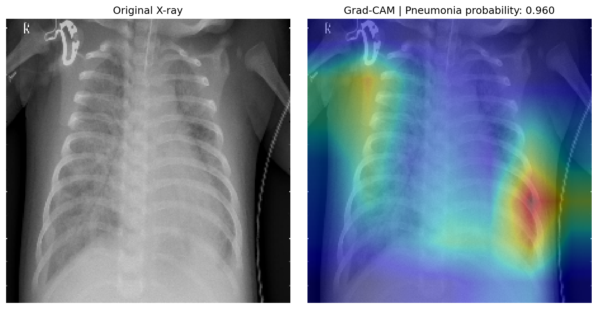

# Pneumonia Detection from Chest X-Ray Images

**A Machine Learning and Deep Learning Project for Medical Image Classification**

## Project Overview

This project explores the classification of chest X-ray images into two categories:

- **NORMAL** — No pneumonia detected.
- **PNEUMONIA** — Pneumonia detected.

The main objective is to compare traditional machine learning approaches with deep learning using transfer learning.

The project also explores model interpretability through Grad-CAM visualizations and provides an interactive interface using Streamlit.

## Models and Methods

The following approaches are implemented and evaluated:

1. **HOG and LBP** — Hand-crafted image feature extraction.
2. **Support Vector Machine (SVM)** — Traditional classification baseline.
3. **Random Forest** — Traditional classification baseline.
4. **MobileNetV2** — Transfer learning for image classification.
5. **Grad-CAM** — Visualization of image regions influencing model predictions.

## Dataset

**Dataset:** Chest X-Ray Images (Pneumonia)  
**Source:** Kaggle — `paultimothymooney/chest-xray-pneumonia`

The dataset contains chest X-ray images organized into NORMAL and PNEUMONIA classes.

The original validation folder is not used. Instead, a stratified validation split is created from the training data. The test set remains separate for final evaluation.

## Dataset Statistics

| Split | NORMAL | PNEUMONIA | Total |
|---|---:|---:|---:|
| Training | 1,140 | 3,293 | 4,433 |
| Validation | 201 | 582 | 783 |
| Test | 234 | 390 | 624 |

## Baseline Results

Initial experiments with hand-crafted image features produced the following results:

| Model | Accuracy | Pneumonia Recall | F1-score |
|---|---:|---:|---:|
| SVM | 98.21% | 99.14% | 98.80% |
| Random Forest | 96.42% | 98.63% | 97.62% |

## MobileNetV2 Results

MobileNetV2 was trained using transfer learning with pretrained ImageNet weights. The backbone was frozen, followed by Global Average Pooling, Dropout, and a sigmoid classification layer.

The model was evaluated on the independent test set.

| Metric | Result |
|---|---:|
| Accuracy | 85.26% |
| Pneumonia Precision | 83.41% |
| Pneumonia Recall | 95.38% |
| Pneumonia F1-score | 89.00% |

### Confusion Matrix

The confusion matrix below shows the classification results on the independent test set.

| Actual / Predicted | NORMAL | PNEUMONIA |
|---|---:|---:|
| NORMAL | 160 | 74 |
| PNEUMONIA | 18 | 372 |


The model correctly classified 372 pneumonia images and 160 normal images. It misclassified 18 pneumonia images as normal and 74 normal images as pneumonia.

## Model Interpretability — Grad-CAM

Grad-CAM was used to visualize image regions that contributed to the model's prediction.

For the example below, MobileNetV2 predicted **PNEUMONIA** with a probability of **96.01%**.



Grad-CAM provides a visual explanation of model behavior. These heatmaps should not be interpreted as clinical evidence or definitive lesion localization.

## Streamlit Application

An interactive web application was developed using Streamlit.

The application allows users to:

- Upload a chest X-ray image (JPG, JPEG, or PNG).
- View the model's predicted class: NORMAL or PNEUMONIA.
- View the predicted pneumonia and normal probabilities.
- Generate a Grad-CAM visualization to inspect image regions influencing the prediction.

### Running the Application

Before running the application, make sure the trained model file is available at:

`models/mobilenetv2_best.keras`

**Note:** The trained model file is not included in this GitHub repository and must be obtained separately.

Run the application from the project root directory:

```bash
streamlit run app.py
```

After starting the application, open the local URL displayed in the terminal (usually `http://localhost:8501`).

## Evaluation Metrics

The project uses:

- Accuracy
- Precision
- Recall
- F1-score
- Confusion Matrix

Particular attention is given to pneumonia recall because false negatives are important in medical image classification.

## Technology Stack

- Python 3.10
- TensorFlow / Keras
- Scikit-learn
- OpenCV
- NumPy
- Pandas
- Matplotlib
- Streamlit
- Pillow

## Project Structure

```text
pneumonia_xray/
├── data/
├── models/
├── outputs/
│   ├── figures/
│   ├── gradcam/
│   └── metrics/
├── src/
├── app.py
├── checkpoint.md
├── requirements.txt
└── README.md
```

## Installation

Clone the repository:

```bash
git clone https://github.com/reyhaanezamzami-gif/pneumonia_xray.git
cd pneumonia_xray
```

Create a virtual environment:

```bash
python -m venv .venv
```

Activate the virtual environment on Windows:

```cmd
.venv\Scripts\activate
```

Install the required dependencies:

```bash
python -m pip install -r requirements.txt
```

**Important:** The dataset, trained model, and pretrained model weights are not included in the repository. They must be obtained separately and placed in the expected project directories.

## Reproducibility

- Random seed: `42`
- Input image size: `224 × 224`
- Stratified validation split
- Independent test set for final evaluation

## Project Status

**Completed — Model training, independent test evaluation, Grad-CAM visualization, and Streamlit application.**

## Disclaimer

This project is intended for educational and research purposes only.

It is not a medical diagnostic tool and must not be used as a substitute for professional medical evaluation or clinical decisions.